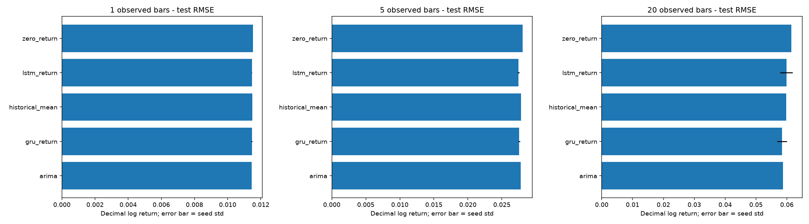

# Stock return forecasting with PyTorch

A reproducible ML engineering project for forecasting future stock log returns
and direction, comparing LSTM, GRU, ARIMA and simple baselines, and serving
versioned predictions through FastAPI. This extends the existing ilboursa/DVC/
Azure project. The conversational LangGraph system is a separate component and
was not redesigned in this work.

**Verified locally:** 1-, 5- and 20-observation BIAT benchmarks, three neural seeds,
walk-forward evaluation, generated reports, saved model bundles, and a live API
smoke test. **Not deployed:** Azure resources/endpoint and container runtime.
See [implementation status](docs/implementation_progress.md) for test outcomes
and explicit limitations.

The new forecasting suite passes cleanly (38 tests, 91% statement coverage).
Legacy CUDA tests pass their assertions but trigger a native Windows shutdown
crash; their CPU path exits cleanly. The old agent-dependent web suite also needs
its missing Gemini configuration. These are documented limitations, not green
whole-repository test claims.

## Results and evidence

BIAT raw data: 2018-01-02 through 2026-10-07, 2,187 observations. The final
one-bar test has 437 origins from 2024-12-31 through 2026-10-06. Models have a
12-epoch maximum budget; validation chooses MSE or Huber across seeds 7, 19, 43.

| Model | One-bar test RMSE (decimal log return) |
|---|---:|
| Zero return / price persistence | 0.011523 |
| Historical mean return | 0.011498 |
| ARIMA | 0.011459 |
| LSTM, mean of three seeds | 0.011462 |
| GRU, mean of three seeds | 0.011463 |

The tiny LSTM/GRU difference is smaller than seed variation. No architecture is
consistently best across horizons. These files do **not** contain verified split/
dividend adjustment metadata or an authoritative Tunis exchange calendar: results
are provider-price returns over observed bars, not verified total returns over
exchange sessions. Unsupported forecast dates and session horizons are null.



Read the [consolidated evaluation](reports/evaluation_report.md),
[model comparison](docs/model_comparison.md), [model card](docs/model_card.md),
and [portfolio/interview summary](docs/portfolio_project_summary.md).
Full predictions, split dates, metrics, bootstrap intervals, HAC tests, histories,
regime results and figures are under reports/biat-h1, biat-h5 and biat-h20.

## Architecture

```text
Existing ilboursa downloads / canonical raw OHLCV
  -> strict validation + explicit price/calendar provenance
  -> immutable local or Azure Blob Parquet snapshot + manifest
  -> causal feature groups + aligned future return/direction labels
  -> purged chronological splits + training-only scalers
  -> PyTorch LSTM / GRU | statsmodels ARIMA | naive baselines
  -> repeated-seed / walk-forward evaluation + next-open backtests
  -> JSON/CSV/plots + optional MLflow
  -> exact-version weights + scaler + feature/target/lineage bundle
  -> standalone FastAPI -> future LangGraph tool
```

The independent stock_forecasting package prevents forecasting from importing
agent credentials or cache clients. Existing src/, downloads, DVC files and
legacy web routes remain. Immediate legacy fixes restore model input validation,
3-D recurrent inference, consistent sequence lengths and train-only scaler use;
processing no longer interpolates calendar dates. The raw data used here were
not overwritten. See the [initial architecture audit](docs/architecture_audit.md).

## Why returns and these models?

The target is log(P[t+h]/P[t]); its historical feature is log(P[t]/P[t-1]). This
separates future labels from known inputs and reduces the misleading fit obtained
by regressing highly persistent price levels. Direction is 1(target_return > 0).
An optional implied price is P[t] * exp(prediction), on the same price basis.

LSTM/GRU share configurable hidden size, layers, dropout, sequence length, horizons,
training budgets and feature groups. Both use batch_first, CPU/CUDA, clipping,
AdamW, validation stopping and LR scheduling. Regression compares MSE/Huber on
train-normalized targets; classification uses BCEWithLogitsLoss. Experimental
multitask learning combines normalized regression and weighted classification;
it is not assumed superior. Checkpoints persist the best validation weights.

ARIMA uses training-only AIC order selection on daily log returns, then appends
actual observations through each forecast origin without refitting parameters.
Multi-step return forecasts sum daily forecasts. Zero return, training mean,
majority direction and training positive frequency are mandatory comparators.
ARIMA is not advertised as a calibrated direction classifier.

Default features cover lagged returns, momentum, moving-average distances,
range/gap/open-close returns, trailing/ewm volatility, ATR and Parkinson volatility.
Volume and RSI/MACD/Bollinger groups are optional for feature ablation. External
context has a publication-time as-of join interface but no macro data is included.

## Local setup and reproducibility

Use Python 3.11 or newer. Existing Windows CUDA setup is documented in
[PyTorch setup](docs/pytorch-training.md). For a clean forecasting-only environment:

```powershell
python -m venv .venv-forecast
.\.venv-forecast\Scripts\Activate.ps1
python -m pip install -e ".[dev]"
```

The old requirements.txt/environment files also contain agent dependencies; they
are not needed for the standalone return pipeline. For reproducible comparisons,
keep config and dataset hashes with the environment versions recorded in reports.
The verified experiment used Python 3.12.8, torch 2.11.0+cu128, NumPy 1.26.4,
pandas 3.0.6, scikit-learn 1.9.1 and statsmodels 0.15.0. CUDA was available.

Existing free-provider download (requires the legacy downloader dependencies and
provider permission; access challenges are surfaced, never bypassed):

```powershell
python -m scripts.download_data --date 01-01-2018
```

Use a supplied local raw CSV if network/provider access is unavailable. Never
train on old interpolated processed files. French ilboursa and canonical OHLCV
CSV formats are accepted. Config is JSON; copy configs/forecast.json for each
symbol, feature set, horizon, task and experiment. The checked-in date cutoff
reproduces this retrospective study, not a live ingestion date.

```powershell
python -m stock_forecasting.cli validate --data data/raw/BIAT.csv
python -m stock_forecasting.cli snapshot --data data/raw/BIAT.csv
python -m stock_forecasting.cli features --data data/raw/BIAT.csv
python -m stock_forecasting.cli analyze --data data/raw/BIAT.csv
python -m stock_forecasting.cli train --data data/raw/BIAT.csv --family lstm
python -m stock_forecasting.cli train --data data/raw/BIAT.csv --family gru --task direction
python -m stock_forecasting.cli train --data data/raw/BIAT.csv --family lstm --task multitask
python -m stock_forecasting.cli train --data data/raw/BIAT.csv --family arima --output reports/arima-training
```

Exact benchmark recipes (use new output directories; old runs are not overwritten):

```powershell
python -m stock_forecasting.cli benchmark --data data/raw/BIAT.csv --output reports/new-h1 --epochs 12 --seeds 7,19,43 --folds 2
python -m stock_forecasting.cli benchmark --data data/raw/BIAT.csv --output reports/new-h5 --horizon 5 --epochs 12 --seeds 7,19,43 --tasks return,direction --folds 1
python -m stock_forecasting.cli benchmark --data data/raw/BIAT.csv --output reports/new-h20 --horizon 20 --epochs 12 --seeds 7,19,43 --tasks return,direction --folds 1
python -m stock_forecasting.cli report --output reports/new-h1
python -m stock_forecasting.summary reports/new-h1 reports/new-h5 reports/new-h20 --output reports/new-summary
```

For ablation, change feature_groups in a copied config and pass --config; preserve
splits, seeds and budgets and compare validation scores before final holdout use.
Do not repeatedly tune against the supplied test results. MLflow is optional via
--mlflow-uri (install .[azure]); otherwise JSON/CSV tracking always works locally.

## Evaluation, stationarity and walk-forward validation

Training labels end strictly before the next split's first origin. Validation
labels are purged before test; scalers use only training input rows. Expanding
walk-forward folds remain within the development period and independently
select settings. All benchmarks use identical origins and target definitions.

Metrics separate regression (including OOS R?), direction, probabilities,
calibration, time-series rank IC, regimes and economic results. HAC loss tests
and block bootstrap account for serial dependence. ADF, KPSS, ARCH-LM and
Ljung?Box are training-only diagnostics; rejection of a unit-root null does not
prove full stationarity. See [methodology](docs/evaluation_methodology.md) and
[statistical analysis](docs/statistical_analysis.md).

## Forecasting accuracy versus trading profitability

Forecasts occur after close and can only trade at the next open. The simulation
holds nonoverlapping positions for the configured horizon and charges entry and
exit costs. It reports gross/net returns, CAGR, Sharpe/Sortino, drawdown, turnover,
exposure and completed-trade metrics. The buy/hold comparator is gross over the
same span. Research shorting has additional borrow assumptions.

In the one-bar study, gross buy/hold returned 72.12%; LSTM regression strategies
ranged from -18.90% to +0.43%, GRU from +0.03% to +6.26%, with 10 bps per side.
Small error improvements did not establish a trading advantage. Missing
adjustment and execution evidence further limits any financial conclusion.

## Why an LSTM may not outperform simpler financial forecasting baselines

Returns are noisy; market efficiency can leave little stable predictive signal.
Nonstationarity and changing regimes weaken relationships learned from history.
Flexible recurrent models can overfit, and results vary with initialization.
Zero returns, historical means and ARIMA can be strong competitors. Transaction
costs can consume small apparent forecasting gains. A portfolio should explain
these measured limitations instead of declaring deep learning the winner.

## API

```powershell
python -m uvicorn stock_forecasting.api:app --host 127.0.0.1 --port 8000
```

GET /health, /ready and /models; POST /v1/predict (alias /predict); OpenAPI /docs.
Request example (replace the version with one returned by /models):

```json
{"symbol":"BIAT","model":"lstm","horizon":1,"task":"return","model_version":"<exact-available-version>"}
```

Responses include model/data versions, as_of, horizon basis, predicted log return,
implied price and nullable probability/target date. The service loads frozen
preprocessing and never refits it. Multiple matching models require an explicit
version. Configure FORECAST_API_KEY and FORECAST_ENV=production for hosting.
See [API guide](docs/inference_api.md); this contract is ready for a future agent
client. Legacy /stock remains a price endpoint and is not the new research API.

## Tests and Azure

```powershell
python -m pip install '.[dev]' azure-storage-blob azure-identity azure-ai-ml
python -m pytest tests/forecasting -q --cov=stock_forecasting
python -m ruff check stock_forecasting tests/forecasting infrastructure/azure/score.py
python -m ruff format --check stock_forecasting tests/forecasting infrastructure/azure/score.py
docker build --target base -t stock-forecast:local .
```

CI runs forecast tests/lint without starting cloud resources. Legacy Azure training
and deployment workflows are manual and use the azure-approved GitHub Environment;
configure required reviewers before dispatch. Importing the old deploy script
no longer creates an endpoint.

[Azure setup](docs/azure_setup.md), [Blob storage](docs/azure_storage.md),
[ML training/registry](docs/azure_ml_training.md), [deployment](docs/azure_deployment.md),
[cost optimization](docs/azure_cost_optimization.md) contain parameterized commands,
RBAC, verification and rollback. SDK actions require --approve-cloud-action;
no cloud writes, jobs, images or live endpoints were created in this session.

## Limitations and future work

Obtain verified adjustment and exchange-session evidence; run multi-stock and
prospective tests; evaluate broader feature ablations; validate probability
calibration; measure peak runtime memory; add delayed-label monitoring and drift
alerts. External context, return distributions, cross-sectional IC and live
production data refresh remain extensions. Azure quota/identity/deployment and
Docker runtime verification remain blocked on the actual environment and approval.
See the model card and implementation checklist for precise scope.


### Integrated notebook and training

Start with [the integration guide](docs/integration_guide.md) for the shared public model classes, explanatory notebook, candidate training, promotion, workflow chain, and release procedure.
