# 5-stock forecasting benchmark

## Scope and decision

Stocks: **BIAT, ATB, ARTES, NAKL, CIL**. Neural training and prediction device: **cuda**; GPU: **NVIDIA GeForce RTX 3050 Ti Laptop GPU**. ARIMA runs on CPU.

The lower equal-stock mean validation relative RMSE among neural return models is **LSTM_return**. The lowest validation score across return models/baselines is **LSTM_return**. This is a retrospective comparison, not deployment approval or a profitability claim. Test results do not choose the winner.

## Model-choice rationale

**Provisional return-model choice: LSTM_return.** The selection rule is the lowest equal-stock mean validation relative RMSE, after averaging seeds within each stock. Direction models are evaluated separately because probability prediction is a different task.

The candidate scores **0.997116** on validation (historical-mean baseline = 1), an error reduction of **0.288%** relative to that baseline. It beats the baseline on **2/5** stocks and has the lowest validation return error on **1/5** stocks.

On test, this candidate scores **1.000522**; the lowest observed test error belongs to **ARIMA** (**0.996132**). Test rankings describe generalization and do not change the validation-based choice. A score above 1 means worse error than the baseline.

This supports a candidate for further validation, not an unconditional production winner. Small average differences and inconsistent stock-level results do not establish a robust advantage; no statistical significance claim is made. Keep ARIMA and the simple baselines as challengers. Before deployment, freeze the candidate settings and evaluate newly collected, unseen observations against those challengers with a predefined acceptance rule. If the candidate does not improve reliably, keep the stronger baseline rather than selecting LSTM because it was preferred.

## Fixed protocol

- Start requested: 2010-01-01; as-of cutoff: 2026-10-10; each stock uses all available completed rows within that range.
- Horizon: 1 observed bar(s). Unverified calendar means these are not guaranteed exchange sessions.
- Maximum epochs: 50; patience: 10; seeds: [7, 19, 43].
- Window: 20; hidden units: 32; layers: 1; dropout: 0.1.
- Batch size: 64; learning rate: 0.001; weight decay: 0.0001.
- Return objective: huber on training-standardized targets; direction objective: binary cross entropy.
- Same public LSTMModel / GRUModel and trainer as routine training. Benchmark overrides history, epoch budget and device; it never refits on test or promotes models.
- Training before 2022-01-01; validation until 2024-01-01 (exclusive); test thereafter. Future labels crossing boundaries are purged. Scalers use training inputs only.
- Both families run each seed for return prediction and separately for direction probability. Validation restores the best epoch; no test-based hyperparameter, seed or trading-threshold selection.
- Model tables average metrics across seeds (not ensemble predictions). Stocks receive equal weight. Relative RMSE uses each stock's historical-mean baseline; relative Brier uses its training-frequency baseline. Values below 1 beat that baseline.
- Forecast, confusion, probability and strategy figures use seed 7 fixed in advance. Learning curves include all seeds.
- Neural latency includes input transfer and CPU result transfer, with warmup excluded and CUDA synchronization. ARIMA latency includes sequential state updates; these workloads differ. GPU speedup over CPU was not measured.
- Stocks were selected for history coverage and valid local OHLCV, not benchmark performance. Actual coverage appears in each stock section. Invalid stocks were not silently repaired.
- Existing historical data and some test periods have been inspected in prior work; this is not a newly unseen prospective test. Unverified corporate actions, data revisions and missing-session evidence limit conclusions.

## Overall results

| phase | model | relative_rmse | relative_brier | mae | accuracy | training_seconds | prediction_ms_per_sample |
|---|---|---|---|---|---|---|---|
| validation | zero_return | 1.000021 | — | 0.010347 | 0.642588 | — | — |
| test | zero_return | 0.999859 | — | 0.009992 | 0.611236 | — | — |
| validation | historical_mean | 1.000000 | — | 0.010387 | 0.624406 | — | — |
| test | historical_mean | 1.000000 | — | 0.010029 | 0.582915 | — | — |
| validation | historical_probability | — | 1.000000 | — | 0.642588 | — | — |
| test | historical_probability | — | 1.000000 | — | 0.611236 | — | — |
| validation | majority_direction | — | — | — | 0.642588 | — | — |
| test | majority_direction | — | — | — | 0.611236 | — | — |
| validation | ARIMA | 1.002528 | — | 0.010507 | 0.583484 | 1.163190 | 10.740373 |
| test | ARIMA | 0.996132 | — | 0.010084 | 0.549538 | 1.163190 | 12.631426 |
| validation | LSTM_return | 0.997116 | — | 0.010657 | 0.517888 | 2.649138 | 0.011455 |
| test | LSTM_return | 1.000522 | — | 0.010279 | 0.533037 | 2.649138 | 0.011555 |
| validation | GRU_return | 1.000840 | — | 0.010664 | 0.522724 | 2.648473 | 0.012156 |
| test | GRU_return | 0.997867 | — | 0.010243 | 0.542034 | 2.648473 | 0.012045 |
| validation | LSTM_direction | — | 0.992823 | — | 0.635391 | 2.863497 | 0.013557 |
| test | LSTM_direction | — | 0.992681 | — | 0.614925 | 2.863497 | 0.012921 |
| validation | GRU_direction | — | 0.994404 | — | 0.636752 | 3.121283 | 0.011702 |
| test | GRU_direction | — | 0.989199 | — | 0.613658 | 3.121283 | 0.012255 |

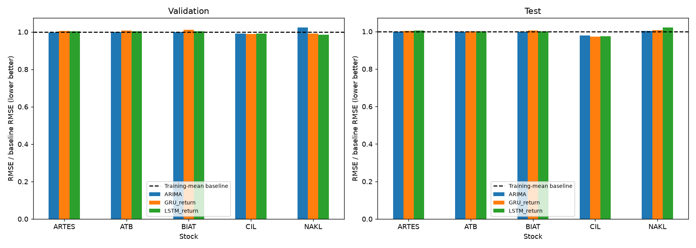

## Reading the metrics

RMSE and MAE measure errors in decimal log returns (lower is better). RMSE emphasizes large errors. Accuracy is the fraction of correct positive/nonpositive signs; compare it with the majority baseline. Brier measures squared probability error (lower is better); ROC-AUC measures ranking (higher is better). Probabilities are uncalibrated sigmoid outputs from trained direction heads, not signs disguised as confidence. Unavailable metrics appear as —. Seed standard deviation describes training variability, not a confidence interval.

Strategies form signals after close, enter at the next open, and hold a nonoverlapping fixed horizon. Costs are 10 bps on each side. Probability signals use 0.5. Buy-and-hold is gross. Zero-volume execution bars make this simple simulation unavailable. Charts are research diagnostics, not deployable trading evidence.

## BIAT

4127 rows: 2010-01-04 to 2026-10-07. ARIMA order: (0, 0, 0). Input SHA-256: `d1405d91963facbf83693f402fbf269019b670f3d1b44f3deeace8b9d46c3174`.

| split | n | first_origin | last_origin | last_label |
|---|---|---|---|---|
| train | 2894 | 2010-03-01 00:00:00 | 2021-12-30 00:00:00 | 2021-12-31 00:00:00 |
| validation | 506 | 2022-01-03 00:00:00 | 2023-12-28 00:00:00 | 2023-12-29 00:00:00 |
| test | 685 | 2024-01-02 00:00:00 | 2026-10-06 00:00:00 | 2026-10-07 00:00:00 |

| phase | model | rmse | rmse_std | mae | accuracy | brier | auc | training_seconds | prediction_ms_per_sample | relative_rmse | relative_brier |
|---|---|---|---|---|---|---|---|---|---|---|---|
| validation | zero_return | 0.010701 | — | 0.006319 | 0.545455 | — | — | — | — | 1.001174 | — |
| test | zero_return | 0.011434 | — | 0.006515 | 0.570803 | — | — | — | — | 1.000982 | — |
| validation | historical_mean | 0.010689 | — | 0.006336 | 0.454545 | — | — | — | — | 1.000000 | — |
| test | historical_mean | 0.011423 | — | 0.006541 | 0.429197 | — | — | — | — | 1.000000 | — |
| validation | historical_probability | — | — | — | 0.545455 | 0.250029 | 0.500000 | — | — | — | 1.000000 |
| test | historical_probability | — | — | — | 0.570803 | 0.245404 | 0.500000 | — | — | — | 1.000000 |
| validation | majority_direction | — | — | — | 0.545455 | — | — | — | — | — | — |
| test | majority_direction | — | — | — | 0.570803 | — | — | — | — | — | — |
| validation | ARIMA | 0.010687 | — | 0.006341 | 0.454545 | — | — | 1.112341 | 11.217341 | 0.999793 | — |
| test | ARIMA | 0.011421 | — | 0.006548 | 0.429197 | — | — | 1.112341 | 13.089676 | 0.999828 | — |
| validation | LSTM_return | 0.010724 | 0.000060 | 0.006465 | 0.467062 | — | — | 2.517544 | 0.010738 | 1.003326 | — |
| test | LSTM_return | 0.011443 | 0.000010 | 0.006648 | 0.475426 | — | — | 2.517544 | 0.011636 | 1.001762 | — |
| validation | GRU_return | 0.010802 | 0.000046 | 0.006579 | 0.453887 | — | — | 2.406387 | 0.010697 | 1.010567 | — |
| test | GRU_return | 0.011480 | 0.000018 | 0.006736 | 0.490024 | — | — | 2.406387 | 0.013659 | 1.005009 | — |
| validation | LSTM_direction | — | — | — | 0.536891 | 0.249819 | 0.472994 | 2.478032 | 0.014737 | — | 0.999162 |
| test | LSTM_direction | — | — | — | 0.568856 | 0.245511 | 0.515203 | 2.478032 | 0.013405 | — | 1.000435 |
| validation | GRU_direction | — | — | — | 0.519763 | 0.250387 | 0.464052 | 2.363187 | 0.010530 | — | 1.001433 |
| test | GRU_direction | — | — | — | 0.560097 | 0.246627 | 0.497996 | 2.363187 | 0.012211 | — | 1.004983 |

### Epochs actually used

| model | seed | epochs_run | best_epoch | device | seconds |
|---|---|---|---|---|---|
| LSTM_return | 7 | 11 | 1 | cuda | 2.746476 |
| LSTM_return | 19 | 11 | 1 | cuda | 2.498461 |
| LSTM_return | 43 | 11 | 1 | cuda | 2.307696 |
| GRU_return | 7 | 13 | 3 | cuda | 2.703700 |
| GRU_return | 19 | 11 | 1 | cuda | 2.166366 |
| GRU_return | 43 | 11 | 1 | cuda | 2.349095 |
| LSTM_direction | 7 | 11 | 1 | cuda | 2.500664 |
| LSTM_direction | 19 | 11 | 1 | cuda | 2.608745 |
| LSTM_direction | 43 | 11 | 1 | cuda | 2.324687 |
| GRU_direction | 7 | 11 | 1 | cuda | 2.284361 |
| GRU_direction | 19 | 11 | 1 | cuda | 2.336534 |
| GRU_direction | 43 | 11 | 1 | cuda | 2.468666 |

### Strategy diagnostics

| model | net_return | max_drawdown | trades | status |
|---|---|---|---|---|
| zero_return | 0.000000 | 0.000000 | 0 | available |
| historical_mean | -0.547520 | -0.562108 | 684 | available |
| historical_probability | 0.000000 | 0.000000 | 0 | available |
| majority_direction | 0.000000 | 0.000000 | 0 | available |
| ARIMA | -0.547520 | -0.562108 | 684 | available |
| LSTM_return | -0.466909 | -0.499074 | 463 | available |
| GRU_return | -0.428891 | -0.458898 | 458 | available |
| LSTM_direction | -0.003780 | -0.003780 | 1 | available |
| GRU_direction | -0.240329 | -0.240329 | 36 | available |

### History and splits

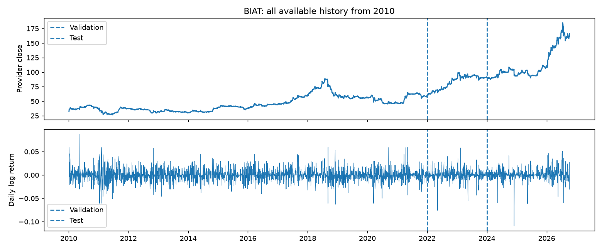

### Training and validation curves

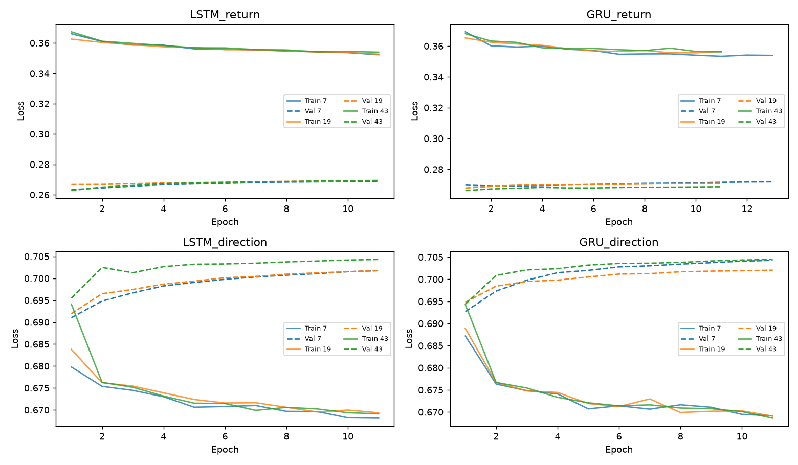

### Forecasts and errors

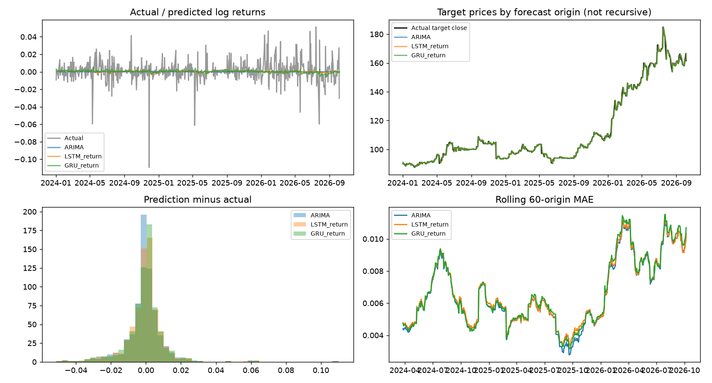

### Confusion matrices

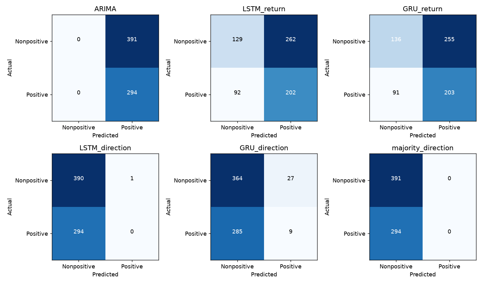

### Probability diagnostics

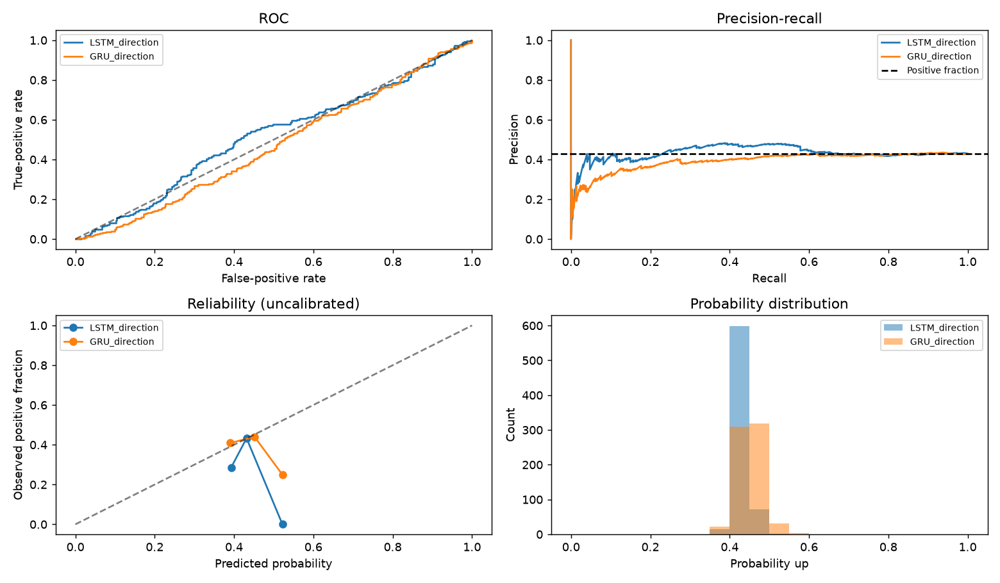

### Strategy and drawdown

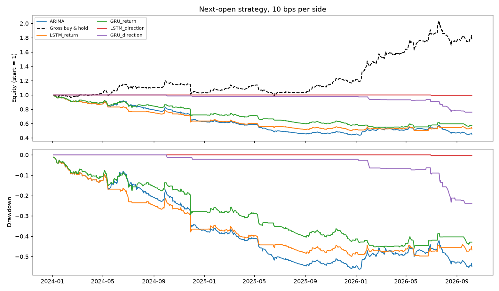

## ATB

3986 rows: 2010-01-04 to 2026-10-07. ARIMA order: (1, 0, 0). Input SHA-256: `0516228716c22e3d897e8657cd6a396566a9ce7b2cf873d3244921a3a1037a93`.

| split | n | first_origin | last_origin | last_label |
|---|---|---|---|---|
| train | 2799 | 2010-03-01 00:00:00 | 2021-12-30 00:00:00 | 2021-12-31 00:00:00 |
| validation | 485 | 2022-01-03 00:00:00 | 2023-12-28 00:00:00 | 2023-12-29 00:00:00 |
| test | 660 | 2024-01-02 00:00:00 | 2026-10-06 00:00:00 | 2026-10-07 00:00:00 |

| phase | model | rmse | rmse_std | mae | accuracy | brier | auc | training_seconds | prediction_ms_per_sample | relative_rmse | relative_brier |
|---|---|---|---|---|---|---|---|---|---|---|---|
| validation | zero_return | 0.016119 | — | 0.010771 | 0.624742 | — | — | — | — | 0.999032 | — |
| test | zero_return | 0.016770 | — | 0.011350 | 0.619697 | — | — | — | — | 0.999027 | — |
| validation | historical_mean | 0.016135 | — | 0.010881 | 0.624742 | — | — | — | — | 1.000000 | — |
| test | historical_mean | 0.016787 | — | 0.011453 | 0.619697 | — | — | — | — | 1.000000 | — |
| validation | historical_probability | — | — | — | 0.624742 | 0.236319 | 0.500000 | — | — | — | 1.000000 |
| test | historical_probability | — | — | — | 0.619697 | 0.238015 | 0.500000 | — | — | — | 1.000000 |
| validation | majority_direction | — | — | — | 0.624742 | — | — | — | — | — | — |
| test | majority_direction | — | — | — | 0.619697 | — | — | — | — | — | — |
| validation | ARIMA | 0.016135 | — | 0.010875 | 0.624742 | — | — | 1.308214 | 10.092306 | 1.000020 | — |
| test | ARIMA | 0.016783 | — | 0.011443 | 0.619697 | — | — | 1.308214 | 12.404718 | 0.999803 | — |
| validation | LSTM_return | 0.016206 | 0.000096 | 0.011059 | 0.615808 | — | — | 2.493131 | 0.011463 | 1.004404 | — |
| test | LSTM_return | 0.016794 | 0.000001 | 0.011547 | 0.614141 | — | — | 2.493131 | 0.011529 | 1.000426 | — |
| validation | GRU_return | 0.016259 | 0.000079 | 0.011076 | 0.570447 | — | — | 2.416962 | 0.013573 | 1.007705 | — |
| test | GRU_return | 0.016801 | 0.000056 | 0.011545 | 0.604040 | — | — | 2.416962 | 0.010927 | 1.000831 | — |
| validation | LSTM_direction | — | — | — | 0.624055 | 0.232255 | 0.568630 | 4.141267 | 0.012868 | — | 0.982802 |
| test | LSTM_direction | — | — | — | 0.619192 | 0.235707 | 0.546609 | 4.141267 | 0.015868 | — | 0.990302 |
| validation | GRU_direction | — | — | — | 0.627491 | 0.233237 | 0.547812 | 5.122680 | 0.013884 | — | 0.986959 |
| test | GRU_direction | — | — | — | 0.623232 | 0.234970 | 0.544304 | 5.122680 | 0.014787 | — | 0.987205 |

### Epochs actually used

| model | seed | epochs_run | best_epoch | device | seconds |
|---|---|---|---|---|---|
| LSTM_return | 7 | 11 | 1 | cuda | 2.248713 |
| LSTM_return | 19 | 11 | 1 | cuda | 2.142004 |
| LSTM_return | 43 | 14 | 4 | cuda | 3.088676 |
| GRU_return | 7 | 11 | 1 | cuda | 2.541357 |
| GRU_return | 19 | 11 | 1 | cuda | 2.270470 |
| GRU_return | 43 | 11 | 1 | cuda | 2.439060 |
| LSTM_direction | 7 | 14 | 4 | cuda | 3.457285 |
| LSTM_direction | 19 | 20 | 10 | cuda | 4.648122 |
| LSTM_direction | 43 | 16 | 6 | cuda | 4.318395 |
| GRU_direction | 7 | 16 | 6 | cuda | 3.928651 |
| GRU_direction | 19 | 20 | 10 | cuda | 4.919366 |
| GRU_direction | 43 | 25 | 15 | cuda | 6.520024 |

### Strategy diagnostics

| model | net_return | max_drawdown | trades | status |
|---|---|---|---|---|
| zero_return | 0.000000 | 0.000000 | 0 | available |
| historical_mean | 0.000000 | 0.000000 | 0 | available |
| historical_probability | 0.000000 | 0.000000 | 0 | available |
| majority_direction | 0.000000 | 0.000000 | 0 | available |
| ARIMA | 0.000000 | 0.000000 | 0 | available |
| LSTM_return | -0.030841 | -0.113481 | 14 | available |
| GRU_return | -0.036181 | -0.262408 | 243 | available |
| LSTM_direction | -0.037874 | -0.037874 | 1 | available |
| GRU_direction | -0.040989 | -0.041312 | 2 | available |

### History and splits

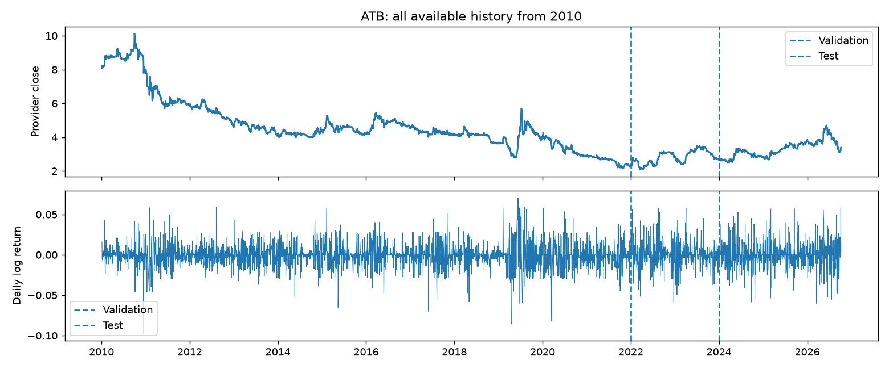

### Training and validation curves

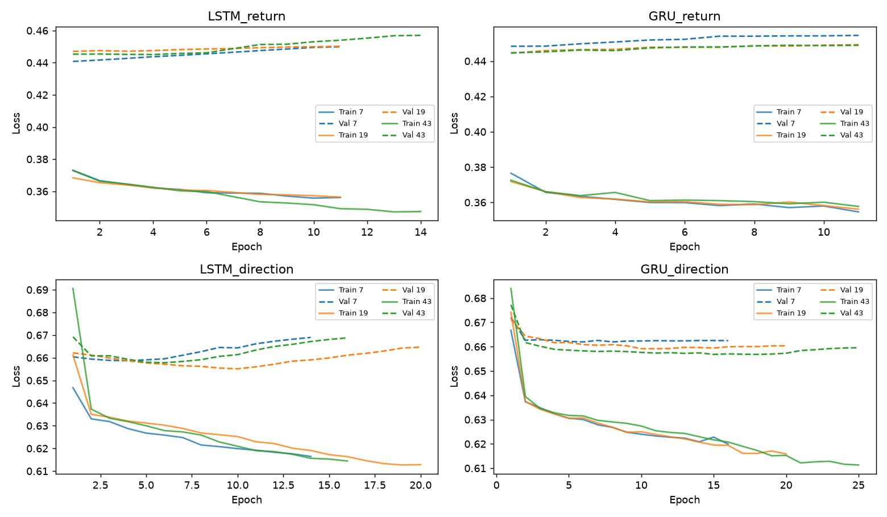

### Forecasts and errors

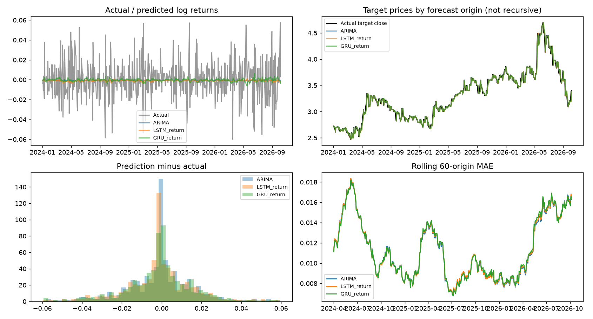

### Confusion matrices

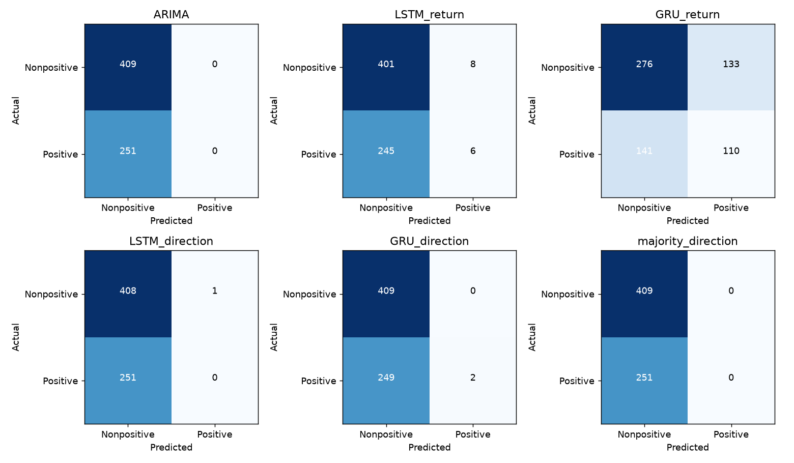

### Probability diagnostics

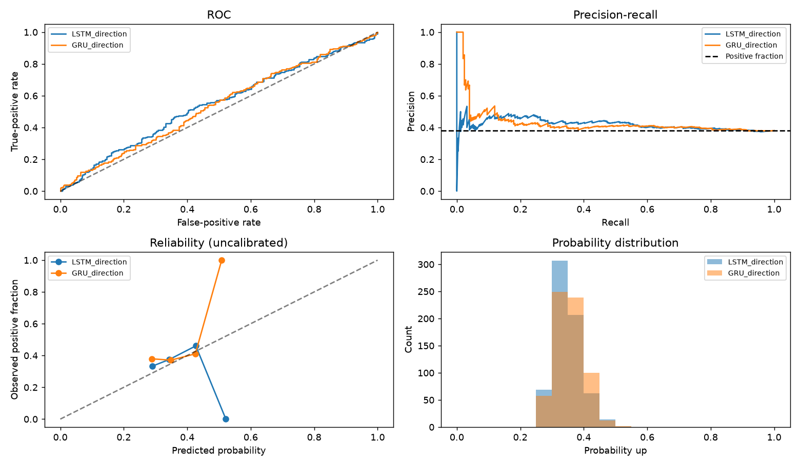

### Strategy and drawdown

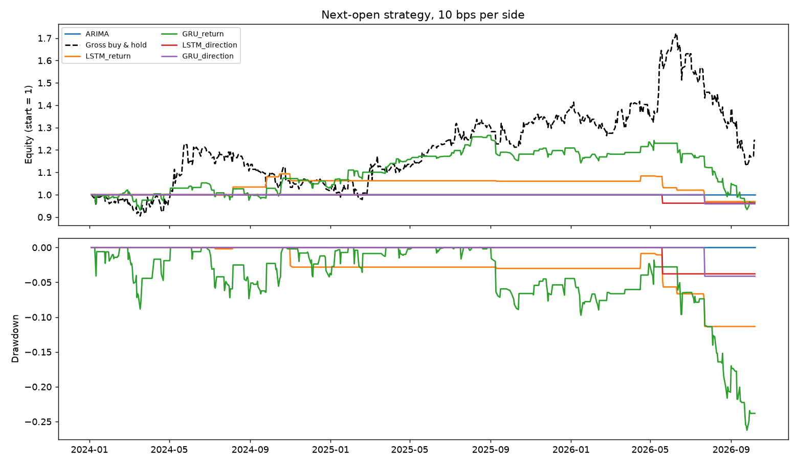

## ARTES

4075 rows: 2010-01-04 to 2026-10-07. ARIMA order: (0, 0, 1). Input SHA-256: `14fcd4052b9dddb1a6a6821fed7ac27af203c3e1dacd1bdefae446a71df792c2`.

| split | n | first_origin | last_origin | last_label |
|---|---|---|---|---|
| train | 2867 | 2010-03-01 00:00:00 | 2021-12-30 00:00:00 | 2021-12-31 00:00:00 |
| validation | 490 | 2022-01-03 00:00:00 | 2023-12-28 00:00:00 | 2023-12-29 00:00:00 |
| test | 676 | 2024-01-02 00:00:00 | 2026-10-06 00:00:00 | 2026-10-07 00:00:00 |

| phase | model | rmse | rmse_std | mae | accuracy | brier | auc | training_seconds | prediction_ms_per_sample | relative_rmse | relative_brier |
|---|---|---|---|---|---|---|---|---|---|---|---|
| validation | zero_return | 0.018129 | — | 0.009450 | 0.657143 | — | — | — | — | 0.999951 | — |
| test | zero_return | 0.015865 | — | 0.010042 | 0.605030 | — | — | — | — | 0.999699 | — |
| validation | historical_mean | 0.018130 | — | 0.009465 | 0.657143 | — | — | — | — | 1.000000 | — |
| test | historical_mean | 0.015870 | — | 0.010055 | 0.605030 | — | — | — | — | 1.000000 | — |
| validation | historical_probability | — | — | — | 0.657143 | 0.225542 | 0.500000 | — | — | — | 1.000000 |
| test | historical_probability | — | — | — | 0.605030 | 0.240320 | 0.500000 | — | — | — | 1.000000 |
| validation | majority_direction | — | — | — | 0.657143 | — | — | — | — | — | — |
| test | majority_direction | — | — | — | 0.605030 | — | — | — | — | — | — |
| validation | ARIMA | 0.018088 | — | 0.009504 | 0.608163 | — | — | 1.323551 | 14.762634 | 0.997678 | — |
| test | ARIMA | 0.015845 | — | 0.010071 | 0.547337 | — | — | 1.323551 | 17.417986 | 0.998440 | — |
| validation | LSTM_return | 0.018186 | 0.000067 | 0.009563 | 0.534014 | — | — | 2.716702 | 0.013440 | 1.003122 | — |
| test | LSTM_return | 0.015950 | 0.000068 | 0.010210 | 0.522189 | — | — | 2.716702 | 0.012118 | 1.005061 | — |
| validation | GRU_return | 0.018231 | 0.000053 | 0.009630 | 0.557143 | — | — | 3.288917 | 0.012226 | 1.005560 | — |
| test | GRU_return | 0.015927 | 0.000009 | 0.010246 | 0.519724 | — | — | 3.288917 | 0.011982 | 1.003636 | — |
| validation | LSTM_direction | — | — | — | 0.655102 | 0.225937 | 0.540668 | 2.863850 | 0.017230 | — | 1.001753 |
| test | LSTM_direction | — | — | — | 0.611933 | 0.239161 | 0.521332 | 2.863850 | 0.014098 | — | 0.995176 |
| validation | GRU_direction | — | — | — | 0.648299 | 0.226978 | 0.539393 | 3.409325 | 0.011989 | — | 1.006368 |
| test | GRU_direction | — | — | — | 0.606016 | 0.238653 | 0.540785 | 3.409325 | 0.010839 | — | 0.993064 |

### Epochs actually used

| model | seed | epochs_run | best_epoch | device | seconds |
|---|---|---|---|---|---|
| LSTM_return | 7 | 11 | 1 | cuda | 2.744093 |
| LSTM_return | 19 | 11 | 1 | cuda | 2.535230 |
| LSTM_return | 43 | 12 | 2 | cuda | 2.870781 |
| GRU_return | 7 | 13 | 3 | cuda | 2.974975 |
| GRU_return | 19 | 15 | 5 | cuda | 3.268506 |
| GRU_return | 43 | 16 | 6 | cuda | 3.623272 |
| LSTM_direction | 7 | 13 | 3 | cuda | 2.691922 |
| LSTM_direction | 19 | 13 | 3 | cuda | 2.922093 |
| LSTM_direction | 43 | 12 | 2 | cuda | 2.977535 |
| GRU_direction | 7 | 16 | 6 | cuda | 3.314208 |
| GRU_direction | 19 | 16 | 6 | cuda | 3.117009 |
| GRU_direction | 43 | 19 | 9 | cuda | 3.796760 |

### Strategy diagnostics

| model | net_return | max_drawdown | trades | status |
|---|---|---|---|---|
| zero_return | 0.000000 | 0.000000 | 0 | available |
| historical_mean | 0.000000 | 0.000000 | 0 | available |
| historical_probability | 0.000000 | 0.000000 | 0 | available |
| majority_direction | 0.000000 | 0.000000 | 0 | available |
| ARIMA | 0.048324 | -0.195915 | 203 | available |
| LSTM_return | -0.368443 | -0.425317 | 345 | available |
| GRU_return | -0.360687 | -0.464633 | 343 | available |
| LSTM_direction | 0.110837 | -0.042160 | 12 | available |
| GRU_direction | 0.023616 | -0.175552 | 62 | available |

### History and splits

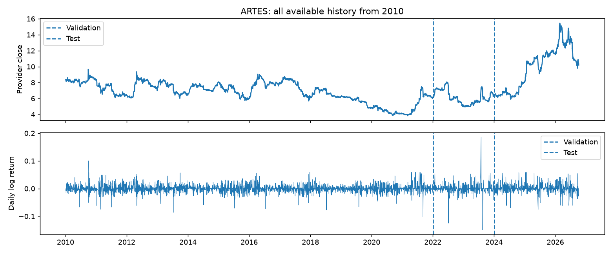

### Training and validation curves

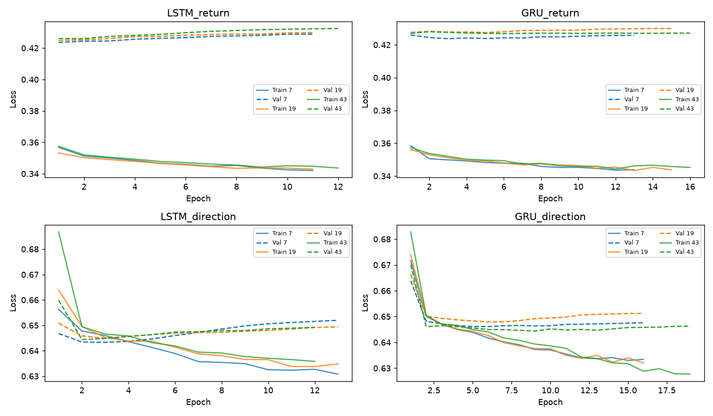

### Forecasts and errors

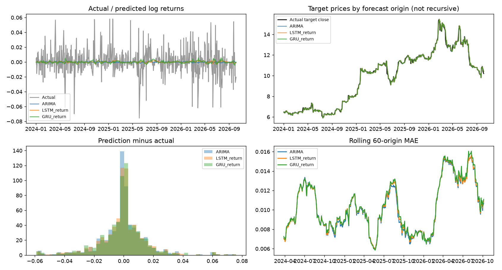

### Confusion matrices

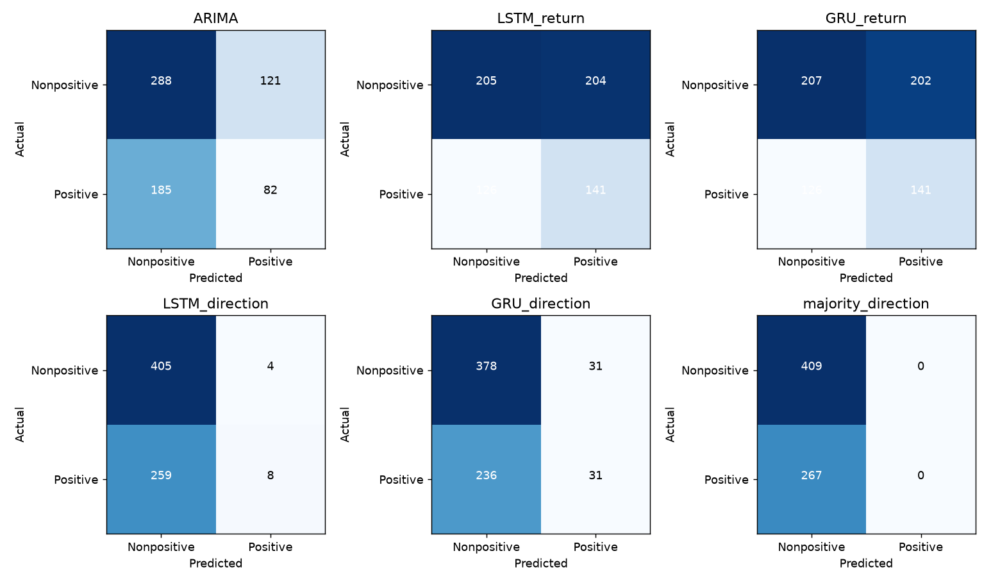

### Probability diagnostics

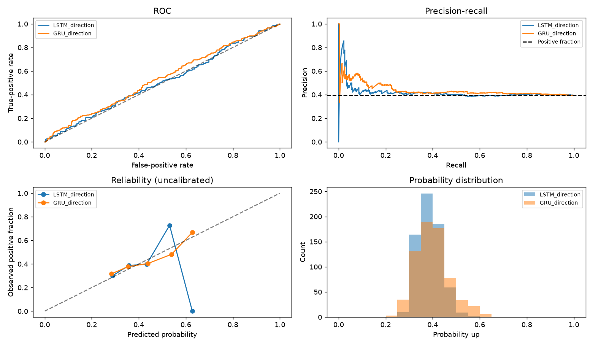

### Strategy and drawdown

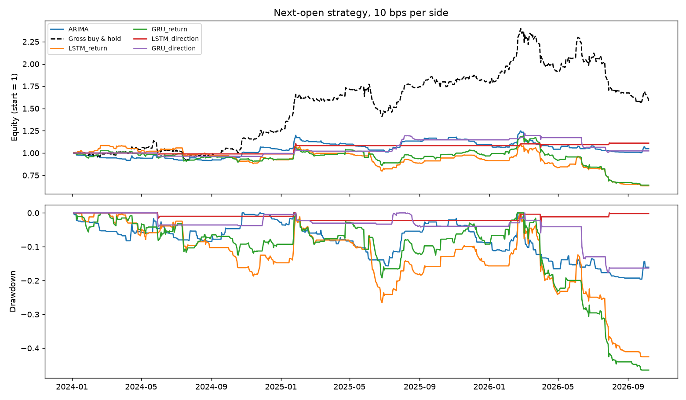

## NAKL

3761 rows: 2010-07-16 to 2026-10-07. ARIMA order: (1, 0, 1). Input SHA-256: `6c220e71bf112d53e92f50df7d9c20fbe44ba58db0273828e1d31d5a89efdf57`.

| split | n | first_origin | last_origin | last_label |
|---|---|---|---|---|
| train | 2727 | 2010-09-17 00:00:00 | 2021-12-30 00:00:00 | 2021-12-31 00:00:00 |
| validation | 362 | 2022-01-03 00:00:00 | 2023-12-27 00:00:00 | 2023-12-28 00:00:00 |
| test | 630 | 2024-01-02 00:00:00 | 2026-10-06 00:00:00 | 2026-10-07 00:00:00 |

| phase | model | rmse | rmse_std | mae | accuracy | brier | auc | training_seconds | prediction_ms_per_sample | relative_rmse | relative_brier |
|---|---|---|---|---|---|---|---|---|---|---|---|
| validation | zero_return | 0.015633 | — | 0.008304 | 0.734807 | — | — | — | — | 0.999989 | — |
| test | zero_return | 0.016036 | — | 0.010276 | 0.639683 | — | — | — | — | 0.999897 | — |
| validation | historical_mean | 0.015633 | — | 0.008322 | 0.734807 | — | — | — | — | 1.000000 | — |
| test | historical_mean | 0.016037 | — | 0.010281 | 0.639683 | — | — | — | — | 1.000000 | — |
| validation | historical_probability | — | — | — | 0.734807 | 0.196701 | 0.500000 | — | — | — | 1.000000 |
| test | historical_probability | — | — | — | 0.639683 | 0.233223 | 0.500000 | — | — | — | 1.000000 |
| validation | majority_direction | — | — | — | 0.734807 | — | — | — | — | — | — |
| test | majority_direction | — | — | — | 0.639683 | — | — | — | — | — | — |
| validation | ARIMA | 0.015995 | — | 0.008790 | 0.558011 | — | — | 1.217312 | 9.793528 | 1.023147 | — |
| test | ARIMA | 0.016088 | — | 0.010521 | 0.509524 | — | — | 1.217312 | 11.170200 | 1.003181 | — |
| validation | LSTM_return | 0.015386 | 0.000124 | 0.008677 | 0.455801 | — | — | 3.197960 | 0.010773 | 0.984235 | — |
| test | LSTM_return | 0.016374 | 0.000185 | 0.010821 | 0.487302 | — | — | 3.197960 | 0.011592 | 1.020989 | — |
| validation | GRU_return | 0.015510 | 0.000049 | 0.008621 | 0.467772 | — | — | 2.833561 | 0.010619 | 0.992169 | — |
| test | GRU_return | 0.016149 | 0.000098 | 0.010526 | 0.524339 | — | — | 2.833561 | 0.013062 | 1.006929 | — |
| validation | LSTM_direction | — | — | — | 0.734807 | 0.196466 | 0.562213 | 2.388579 | 0.011802 | — | 0.998806 |
| test | LSTM_direction | — | — | — | 0.638624 | 0.237070 | 0.486183 | 2.388579 | 0.011077 | — | 1.016495 |
| validation | GRU_direction | — | — | — | 0.733886 | 0.195722 | 0.571885 | 2.466202 | 0.012156 | — | 0.995023 |
| test | GRU_direction | — | — | — | 0.638624 | 0.234827 | 0.486699 | 2.466202 | 0.011765 | — | 1.006880 |

### Epochs actually used

| model | seed | epochs_run | best_epoch | device | seconds |
|---|---|---|---|---|---|
| LSTM_return | 7 | 17 | 7 | cuda | 3.070374 |
| LSTM_return | 19 | 19 | 9 | cuda | 3.334030 |
| LSTM_return | 43 | 18 | 8 | cuda | 3.189476 |
| GRU_return | 7 | 21 | 11 | cuda | 3.744610 |
| GRU_return | 19 | 15 | 5 | cuda | 2.716785 |
| GRU_return | 43 | 12 | 2 | cuda | 2.039288 |
| LSTM_direction | 7 | 14 | 4 | cuda | 2.638518 |
| LSTM_direction | 19 | 12 | 2 | cuda | 2.325376 |
| LSTM_direction | 43 | 12 | 2 | cuda | 2.201843 |
| GRU_direction | 7 | 13 | 3 | cuda | 2.658151 |
| GRU_direction | 19 | 14 | 4 | cuda | 2.720742 |
| GRU_direction | 43 | 12 | 2 | cuda | 2.019712 |

### Strategy diagnostics

| model | net_return | max_drawdown | trades | status |
|---|---|---|---|---|
| zero_return | 0.000000 | 0.000000 | 0 | available |
| historical_mean | 0.000000 | 0.000000 | 0 | available |
| historical_probability | 0.000000 | 0.000000 | 0 | available |
| majority_direction | 0.000000 | 0.000000 | 0 | available |
| ARIMA | -0.291377 | -0.523450 | 273 | available |
| LSTM_return | -0.321783 | -0.383271 | 278 | available |
| GRU_return | -0.358019 | -0.403683 | 216 | available |
| LSTM_direction | -0.020535 | -0.020535 | 2 | available |
| GRU_direction | 0.000000 | 0.000000 | 0 | available |

### History and splits

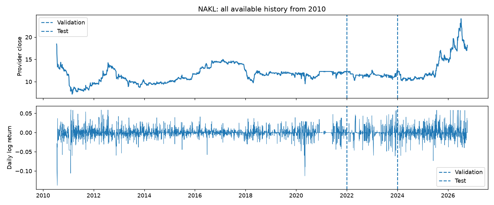

### Training and validation curves

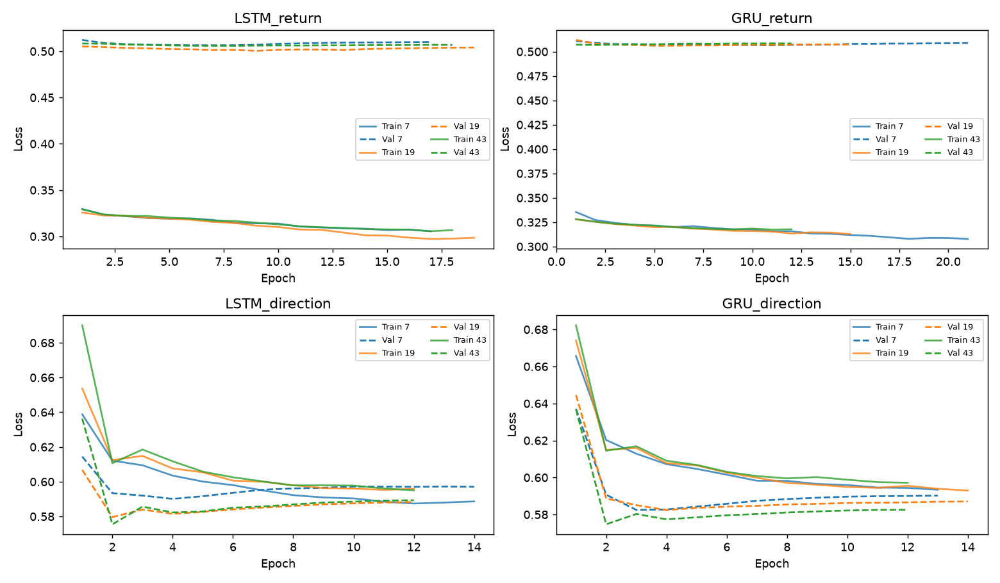

### Forecasts and errors

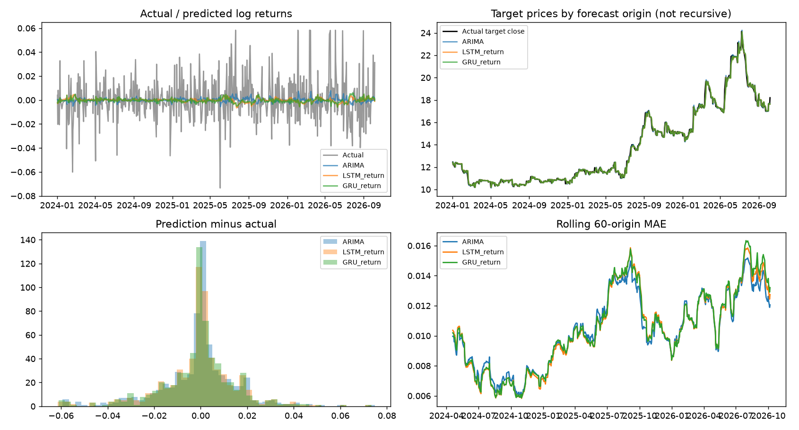

### Confusion matrices

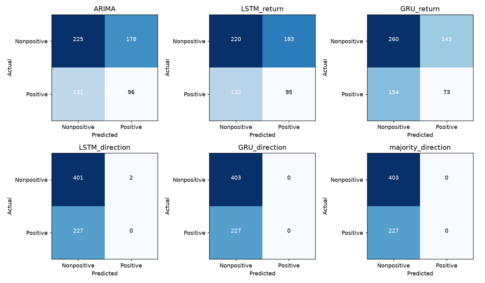

### Probability diagnostics

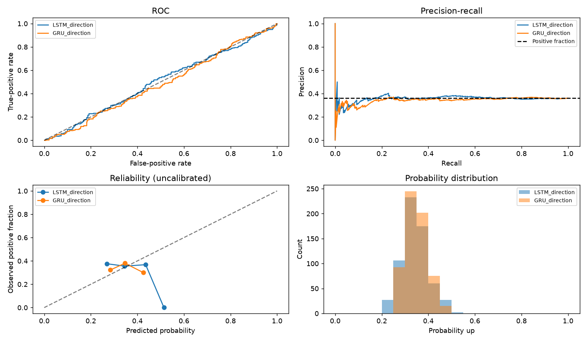

### Strategy and drawdown

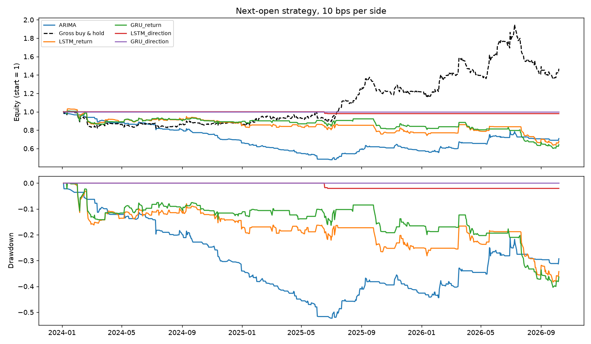

## CIL

3009 rows: 2010-01-04 to 2026-10-07. ARIMA order: (1, 0, 0). Input SHA-256: `a0bd275d0319af6f2fbea3722f8a697900c099d0f708af5c9fb78b4a59a4533a`.

| split | n | first_origin | last_origin | last_label |
|---|---|---|---|---|
| train | 2158 | 2010-03-02 00:00:00 | 2021-12-24 00:00:00 | 2021-12-30 00:00:00 |
| validation | 189 | 2022-01-07 00:00:00 | 2023-12-27 00:00:00 | 2023-12-28 00:00:00 |
| test | 620 | 2024-01-02 00:00:00 | 2026-10-06 00:00:00 | 2026-10-07 00:00:00 |

| phase | model | rmse | rmse_std | mae | accuracy | brier | auc | training_seconds | prediction_ms_per_sample | relative_rmse | relative_brier |
|---|---|---|---|---|---|---|---|---|---|---|---|
| validation | zero_return | 0.036110 | — | 0.016890 | 0.650794 | — | — | — | — | 0.999960 | — |
| test | zero_return | 0.019535 | — | 0.011777 | 0.620968 | — | — | — | — | 0.999692 | — |
| validation | historical_mean | 0.036111 | — | 0.016930 | 0.650794 | — | — | — | — | 1.000000 | — |
| test | historical_mean | 0.019541 | — | 0.011813 | 0.620968 | — | — | — | — | 1.000000 | — |
| validation | historical_probability | — | — | — | 0.650794 | 0.227361 | 0.500000 | — | — | — | 1.000000 |
| test | historical_probability | — | — | — | 0.620968 | 0.236953 | 0.500000 | — | — | — | 1.000000 |
| validation | majority_direction | — | — | — | 0.650794 | — | — | — | — | — | — |
| test | majority_direction | — | — | — | 0.620968 | — | — | — | — | — | — |
| validation | ARIMA | 0.035822 | — | 0.017024 | 0.671958 | — | — | 0.854532 | 7.836055 | 0.992003 | — |
| test | ARIMA | 0.019139 | — | 0.011837 | 0.641935 | — | — | 0.854532 | 9.074550 | 0.979410 | — |
| validation | LSTM_return | 0.035768 | 0.000022 | 0.017521 | 0.516755 | — | — | 2.320354 | 0.010861 | 0.990492 | — |
| test | LSTM_return | 0.019040 | 0.000018 | 0.012169 | 0.566129 | — | — | 2.320354 | 0.010902 | 0.974370 | — |
| validation | GRU_return | 0.035685 | 0.000061 | 0.017411 | 0.564374 | — | — | 2.296536 | 0.013669 | 0.988201 | — |
| test | GRU_return | 0.019012 | 0.000021 | 0.012164 | 0.572043 | — | — | 2.296536 | 0.010595 | 0.972928 | — |
| validation | LSTM_direction | — | — | — | 0.626102 | 0.223176 | 0.597191 | 2.445759 | 0.011148 | — | 0.981590 |
| test | LSTM_direction | — | — | — | 0.636022 | 0.227711 | 0.609093 | 2.445759 | 0.010155 | — | 0.960997 |
| validation | GRU_direction | — | — | — | 0.654321 | 0.223322 | 0.577030 | 2.245020 | 0.009951 | — | 0.982235 |
| test | GRU_direction | — | — | — | 0.640323 | 0.226021 | 0.618243 | 2.245020 | 0.011673 | — | 0.953864 |

### Epochs actually used

| model | seed | epochs_run | best_epoch | device | seconds |
|---|---|---|---|---|---|
| LSTM_return | 7 | 17 | 7 | cuda | 2.442179 |
| LSTM_return | 19 | 17 | 7 | cuda | 2.380583 |
| LSTM_return | 43 | 16 | 6 | cuda | 2.138299 |
| GRU_return | 7 | 17 | 7 | cuda | 2.078540 |
| GRU_return | 19 | 18 | 8 | cuda | 2.459713 |
| GRU_return | 43 | 17 | 7 | cuda | 2.351355 |
| LSTM_direction | 7 | 17 | 7 | cuda | 2.350787 |
| LSTM_direction | 19 | 17 | 7 | cuda | 2.452049 |
| LSTM_direction | 43 | 19 | 9 | cuda | 2.534442 |
| GRU_direction | 7 | 19 | 9 | cuda | 2.567716 |
| GRU_direction | 19 | 15 | 5 | cuda | 1.907866 |
| GRU_direction | 43 | 16 | 6 | cuda | 2.259477 |

### Strategy diagnostics

| model | net_return | max_drawdown | trades | status |
|---|---|---|---|---|
| zero_return | 0.000000 | 0.000000 | 0 | available |
| historical_mean | 0.000000 | 0.000000 | 0 | available |
| historical_probability | 0.000000 | 0.000000 | 0 | available |
| majority_direction | 0.000000 | 0.000000 | 0 | available |
| ARIMA | 0.359253 | -0.173920 | 198 | available |
| LSTM_return | 0.787228 | -0.124825 | 287 | available |
| GRU_return | 1.229381 | -0.081070 | 269 | available |
| LSTM_direction | 0.202525 | -0.073954 | 28 | available |
| GRU_direction | 0.655609 | -0.114457 | 57 | available |

### History and splits

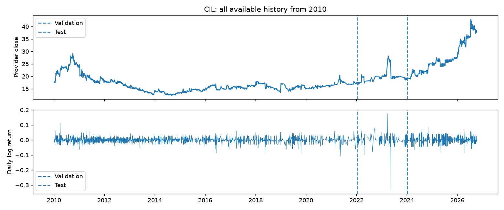

### Training and validation curves

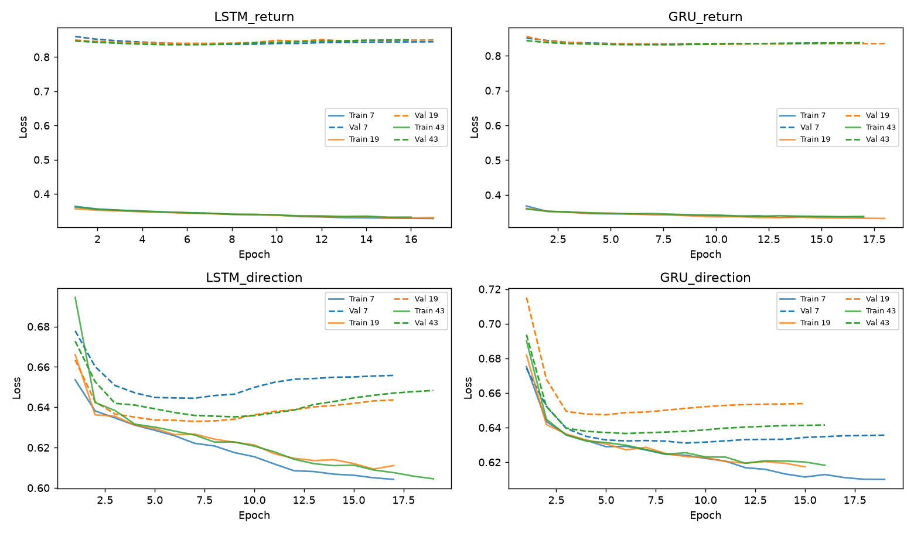

### Forecasts and errors

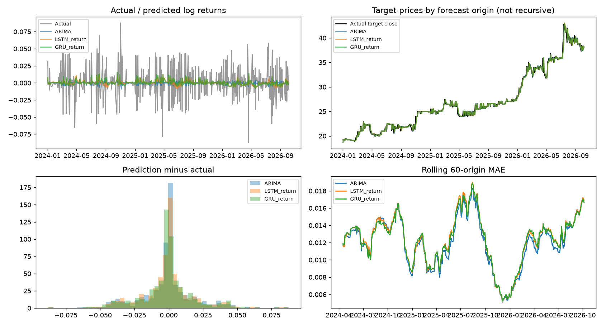

### Confusion matrices

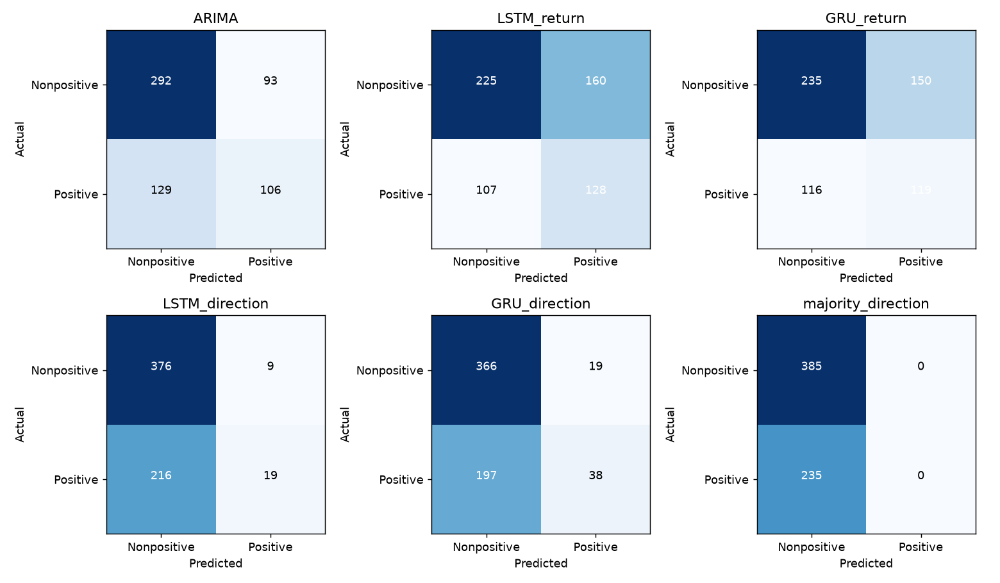

### Probability diagnostics

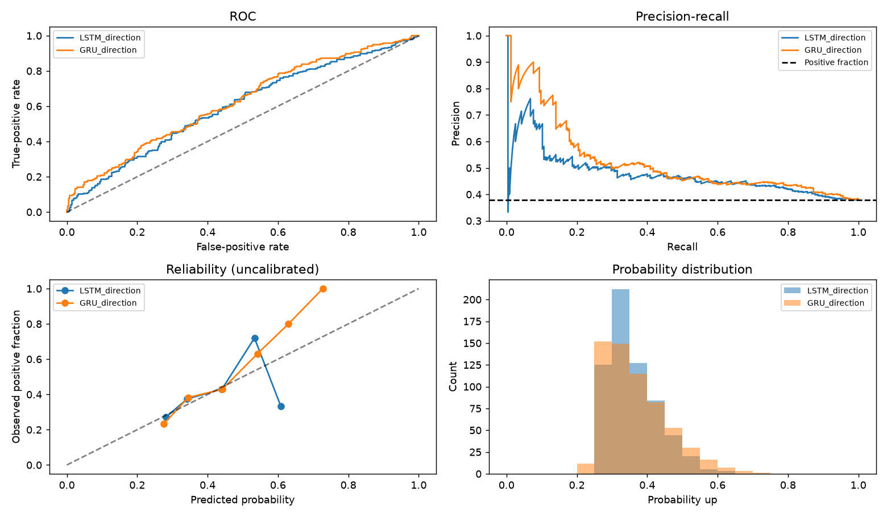

### Strategy and drawdown

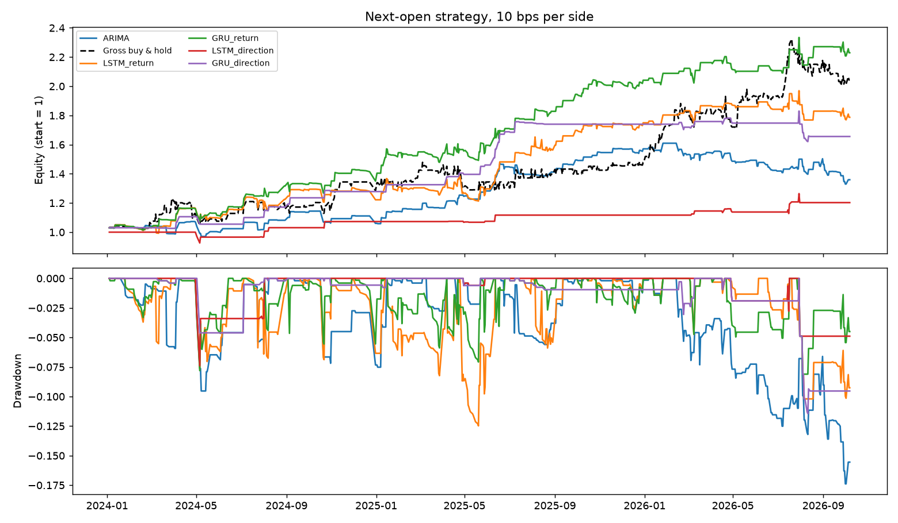

## Files and next decision

This report and the figures are the only exported results. Displayed tables are saved in notebook outputs; full predictions exist only in the live kernel and require rerunning after restart. No deployment model or data snapshot is written. Review validation consistency across stocks before accepting a model family. This report does not establish that LSTM is best, nor guarantee that any learned model improves on simple baselines. Future monitoring and release gates remain separate work.
