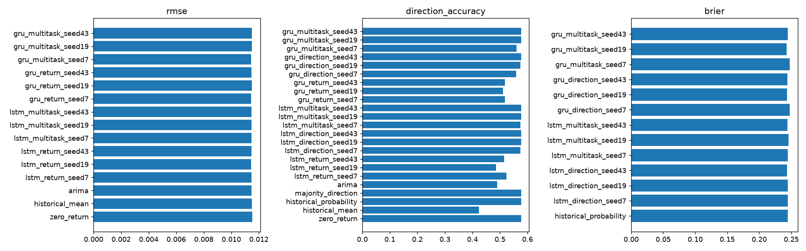

# Reproducible benchmark report

Dataset: `e2cdd1b2408a383b4dcb`; BIAT, 2018-01-02 to 2026-10-07.

Horizon: 1; basis: **observed_bars_unverified_sessions**; adjustments: **unverified**.

Validation selects loss settings; seeds are replicated, not cherry-picked. Final holdout is scored once per selected model/seed. Walk-forward development results are separate. No test-based trading thresholds. See benchmark_summary.json for exact split dates and paired statistics.

| Model | RMSE | Direction accuracy | Brier | Net strategy return |
|---|---:|---:|---:|---:|
| zero_return | 0.011523 | 0.576659 | — | 0.000000 |
| historical_mean | 0.011498 | 0.423341 | — | -0.280227 |
| historical_probability | — | 0.576659 | 0.244291 | 0.000000 |
| majority_direction | — | 0.576659 | — | 0.000000 |
| arima | 0.011459 | 0.489703 | — | -0.074752 |
| lstm_return_seed7 | 0.011473 | 0.524027 | — | 0.004260 |
| lstm_return_seed19 | 0.011449 | 0.485126 | — | -0.188993 |
| lstm_return_seed43 | 0.011463 | 0.514874 | — | -0.124389 |
| lstm_direction_seed7 | — | 0.574371 | 0.244561 | -0.003780 |
| lstm_direction_seed19 | — | 0.576659 | 0.244593 | 0.000000 |
| lstm_direction_seed43 | — | 0.576659 | 0.243251 | 0.000000 |
| lstm_multitask_seed7 | 0.011465 | 0.574371 | 0.244675 | -0.037618 |
| lstm_multitask_seed19 | 0.011456 | 0.576659 | 0.245422 | -0.153512 |
| lstm_multitask_seed43 | 0.011458 | 0.576659 | 0.243612 | -0.074360 |
| gru_return_seed7 | 0.011436 | 0.517162 | — | 0.000272 |
| gru_return_seed19 | 0.011479 | 0.510297 | — | 0.062621 |
| gru_return_seed43 | 0.011473 | 0.517162 | — | 0.024652 |
| gru_direction_seed7 | — | 0.558352 | 0.247830 | -0.148536 |
| gru_direction_seed19 | — | 0.574371 | 0.243206 | 0.027178 |
| gru_direction_seed43 | — | 0.576659 | 0.244142 | 0.000000 |
| gru_multitask_seed7 | 0.011424 | 0.560641 | 0.247628 | 0.049711 |
| gru_multitask_seed19 | 0.011488 | 0.576659 | 0.242765 | 0.033578 |
| gru_multitask_seed43 | 0.011481 | 0.576659 | 0.244568 | 0.031425 |

Returns are decimal units. The zero-return baseline also implies previous-close price persistence. Classification scores are uncalibrated sigmoid probabilities; regression sign is never a probability.

Economic simulation: after-close signal, next-open execution, fixed-horizon nonoverlapping holdings. Costs and borrow assumptions are configurable. Raw/unverified corporate actions and sparse sessions prevent investable performance claims. No causal inference, profitability promise or cross-sectional IC claim follows from this single-asset experiment.

Training-only ADF/KPSS/ARCH/Ljung–Box results are in statistical_analysis.json. ADF rejection does not establish full stationarity. Multiple comparisons and retrospective data revisions remain limitations.