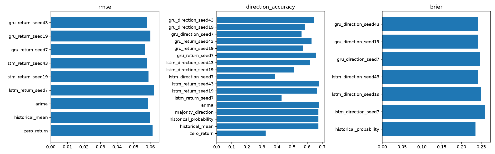

# Reproducible benchmark report

Dataset: `e2cdd1b2408a383b4dcb`; BIAT, 2018-01-02 to 2026-10-07.

Horizon: 20; basis: **observed_bars_unverified_sessions**; adjustments: **unverified**.

Validation selects loss settings; seeds are replicated, not cherry-picked. Final holdout is scored once per selected model/seed. Walk-forward development results are separate. No test-based trading thresholds. See benchmark_summary.json for exact split dates and paired statistics.

| Model | RMSE | Direction accuracy | Brier | Net strategy return |
|---|---:|---:|---:|---:|
| zero_return | 0.061398 | 0.325359 | — | 0.000000 |
| historical_mean | 0.059808 | 0.674641 | — | 0.699617 |
| historical_probability | — | 0.674641 | 0.235266 | 0.699617 |
| majority_direction | — | 0.674641 | — | 0.699617 |
| arima | 0.058778 | 0.677033 | — | 0.699617 |
| lstm_return_seed7 | 0.062164 | 0.430622 | — | 0.304477 |
| lstm_return_seed19 | 0.059028 | 0.667464 | — | 0.685665 |
| lstm_return_seed43 | 0.058318 | 0.681818 | — | 0.699617 |
| lstm_direction_seed7 | — | 0.389952 | 0.260046 | 0.186231 |
| lstm_direction_seed19 | — | 0.511962 | 0.250143 | 0.571020 |
| lstm_direction_seed43 | — | 0.622010 | 0.241939 | 0.638202 |
| gru_return_seed7 | 0.057032 | 0.660287 | — | 0.655159 |
| gru_return_seed19 | 0.060080 | 0.574163 | — | 0.832969 |
| gru_return_seed43 | 0.058116 | 0.629187 | — | 0.605711 |
| gru_direction_seed7 | — | 0.562201 | 0.246894 | 0.292900 |
| gru_direction_seed19 | — | 0.583732 | 0.242930 | 0.707042 |
| gru_direction_seed43 | — | 0.645933 | 0.240603 | 0.685665 |

Returns are decimal units. The zero-return baseline also implies previous-close price persistence. Classification scores are uncalibrated sigmoid probabilities; regression sign is never a probability.

Economic simulation: after-close signal, next-open execution, fixed-horizon nonoverlapping holdings. Costs and borrow assumptions are configurable. Raw/unverified corporate actions and sparse sessions prevent investable performance claims. No causal inference, profitability promise or cross-sectional IC claim follows from this single-asset experiment.

Training-only ADF/KPSS/ARCH/Ljung–Box results are in statistical_analysis.json. ADF rejection does not establish full stationarity. Multiple comparisons and retrospective data revisions remain limitations.