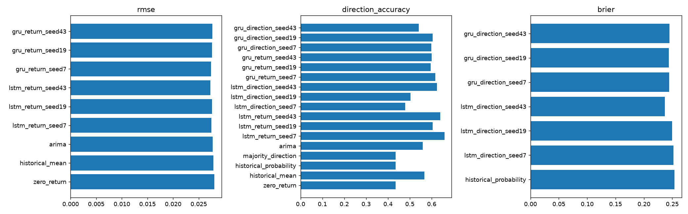
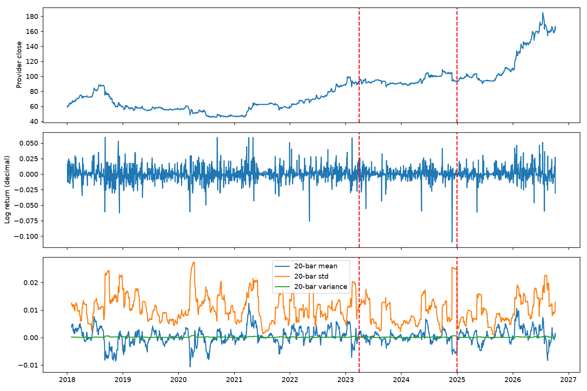

# Reproducible benchmark report

Dataset: `e2cdd1b2408a383b4dcb`; BIAT, 2018-01-02 to 2026-10-07.

Horizon: 5; basis: **observed_bars_unverified_sessions**; adjustments: **unverified**.

Validation selects loss settings; seeds are replicated, not cherry-picked. Final holdout is scored once per selected model/seed. Walk-forward development results are separate. No test-based trading thresholds. See benchmark_summary.json for exact split dates and paired statistics.

| Model | RMSE | Direction accuracy | Brier | Net strategy return |
|---|---:|---:|---:|---:|
| zero_return | 0.028069 | 0.434180 | — | 0.000000 |
| historical_mean | 0.027828 | 0.565820 | — | 0.491330 |
| historical_probability | — | 0.434180 | 0.253674 | 0.000000 |
| majority_direction | — | 0.434180 | — | 0.000000 |
| arima | 0.027747 | 0.558891 | — | 0.436635 |
| lstm_return_seed7 | 0.027490 | 0.658199 | — | 0.599998 |
| lstm_return_seed19 | 0.027562 | 0.605081 | — | 0.560257 |
| lstm_return_seed43 | 0.027258 | 0.639723 | — | 0.480584 |
| lstm_direction_seed7 | — | 0.478060 | 0.251964 | 0.106629 |
| lstm_direction_seed19 | — | 0.503464 | 0.249780 | 0.194937 |
| lstm_direction_seed43 | — | 0.623557 | 0.236831 | 0.450735 |
| gru_return_seed7 | 0.027404 | 0.616628 | — | 0.613268 |
| gru_return_seed19 | 0.027565 | 0.595843 | — | 0.538005 |
| gru_return_seed43 | 0.027632 | 0.600462 | — | 0.370427 |
| gru_direction_seed7 | — | 0.598152 | 0.244454 | 0.256994 |
| gru_direction_seed19 | — | 0.605081 | 0.243971 | 0.187110 |
| gru_direction_seed43 | — | 0.540416 | 0.245150 | 0.489111 |

Returns are decimal units. The zero-return baseline also implies previous-close price persistence. Classification scores are uncalibrated sigmoid probabilities; regression sign is never a probability.

Economic simulation: after-close signal, next-open execution, fixed-horizon nonoverlapping holdings. Costs and borrow assumptions are configurable. Raw/unverified corporate actions and sparse sessions prevent investable performance claims. No causal inference, profitability promise or cross-sectional IC claim follows from this single-asset experiment.

Training-only ADF/KPSS/ARCH/Ljung–Box results are in statistical_analysis.json. ADF rejection does not establish full stationarity. Multiple comparisons and retrospective data revisions remain limitations.