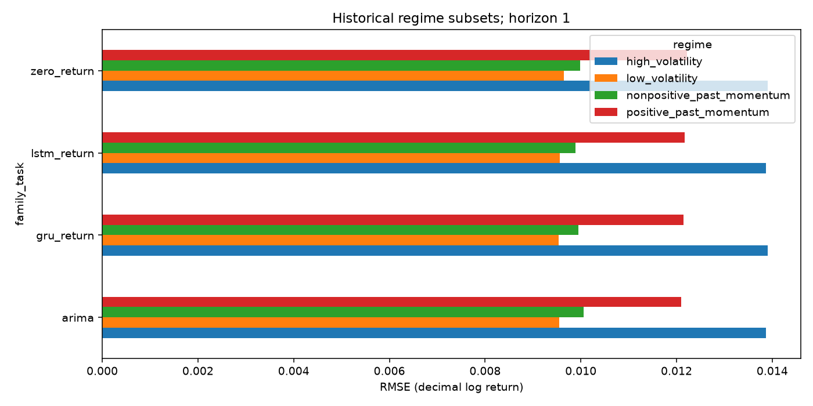

# Consolidated forecasting evaluation

BIAT 2018-01-02 to 2026-10-07; h=1, basis=observed_bars_unverified_sessions, adjustment=unverified, epoch budget=12
BIAT 2018-01-02 to 2026-10-07; h=5, basis=observed_bars_unverified_sessions, adjustment=unverified, epoch budget=12
BIAT 2018-01-02 to 2026-10-07; h=20, basis=observed_bars_unverified_sessions, adjustment=unverified, epoch budget=12

Seed-averaged scores below describe separate fitted models, not an ensemble. Validation selects loss settings; final test results never select seeds. Values are decimal log-return units. Consult source reports for seeds and exact split dates.

| Horizon | Model/task | Mean RMSE | Seed std | Mean direction accuracy | Mean Brier |
|---:|---|---:|---:|---:|---:|
| 1 | arima | 0.011459 | n/a | 0.489703 | n/a |
| 1 | gru_direction | n/a | n/a | 0.569794 | 0.245059 |
| 1 | gru_multitask | 0.011464 | 0.000035 | 0.571320 | 0.244987 |
| 1 | gru_return | 0.011463 | 0.000023 | 0.514874 | n/a |
| 1 | historical_mean | 0.011498 | n/a | 0.423341 | n/a |
| 1 | historical_probability | n/a | n/a | 0.576659 | 0.244291 |
| 1 | lstm_direction | n/a | n/a | 0.575896 | 0.244135 |
| 1 | lstm_multitask | 0.011460 | 0.000005 | 0.575896 | 0.244570 |
| 1 | lstm_return | 0.011462 | 0.000012 | 0.508009 | n/a |
| 1 | majority_direction | n/a | n/a | 0.576659 | n/a |
| 1 | zero_return | 0.011523 | n/a | 0.576659 | n/a |
| 5 | arima | 0.027747 | n/a | 0.558891 | n/a |
| 5 | gru_direction | n/a | n/a | 0.581216 | 0.244525 |
| 5 | gru_return | 0.027533 | 0.000117 | 0.604311 | n/a |
| 5 | historical_mean | 0.027828 | n/a | 0.565820 | n/a |
| 5 | historical_probability | n/a | n/a | 0.434180 | 0.253674 |
| 5 | lstm_direction | n/a | n/a | 0.535027 | 0.246192 |
| 5 | lstm_return | 0.027436 | 0.000159 | 0.634334 | n/a |
| 5 | majority_direction | n/a | n/a | 0.434180 | n/a |
| 5 | zero_return | 0.028069 | n/a | 0.434180 | n/a |
| 20 | arima | 0.058778 | n/a | 0.677033 | n/a |
| 20 | gru_direction | n/a | n/a | 0.597289 | 0.243476 |
| 20 | gru_return | 0.058409 | 0.001545 | 0.621212 | n/a |
| 20 | historical_mean | 0.059808 | n/a | 0.674641 | n/a |
| 20 | historical_probability | n/a | n/a | 0.674641 | 0.235266 |
| 20 | lstm_direction | n/a | n/a | 0.507974 | 0.250709 |
| 20 | lstm_return | 0.059837 | 0.002046 | 0.593301 | n/a |
| 20 | majority_direction | n/a | n/a | 0.674641 | n/a |
| 20 | zero_return | 0.061398 | n/a | 0.325359 | n/a |


A best seed cannot establish an architecture winner. Compare seed variation, training-derived baselines, walk-forward periods and paired HAC statistics. Paired p-values and dependence-aware loss-difference intervals are in paired_statistics.json; comparisons are exploratory and not multiple-testing corrected.



Training-only statistical diagnostics are stored with each source report. Unit-root rejection is not proof of full stationarity or useful return predictability. Probability heads are uncalibrated.

Economic simulations use next-open execution and nonoverlapping positions. Cost, threshold and holding assumptions are recorded in each configuration. Compare within horizon against the same-span gross buy/hold result. Unknown adjustments, sparse sessions and liquidity limit financial conclusions.

See docs/model_comparison.md for the dated interpretation of the supplied BIAT experiments.

## Detailed artifacts

- [biat-h1](biat-h1/evaluation_report.md): exact origins, forecasts, regimes, fold metrics, plots, training histories and versions.
- [biat-h5](biat-h5/evaluation_report.md): exact origins, forecasts, regimes, fold metrics, plots, training histories and versions.
- [biat-h20](biat-h20/evaluation_report.md): exact origins, forecasts, regimes, fold metrics, plots, training histories and versions.

## Reproduction

```powershell
python -m stock_forecasting.summary reports\biat-h1 reports\biat-h5 reports\biat-h20
```

This command aggregates existing runs. It does not refit or choose a model based on the holdout.